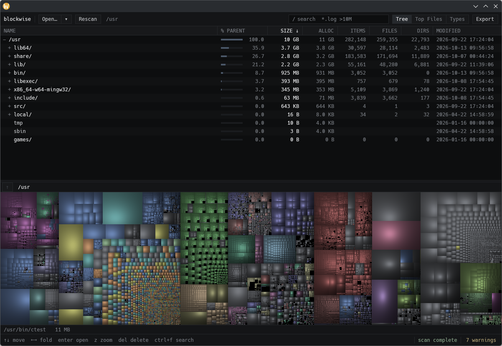

# blockwise

A fast, dark, keyboard-driven disk usage visualizer for Linux: a sortable folder tree on top and a cushion-shaded
treemap below, in the spirit of WizTree and WinDirStat. Built in Rust on [GPUI](https://www.gpui.rs/).



## Features

- **Fast parallel scan:** directories are read on all cores. Top-level folder totals stream in while the scan runs.
  Kernel pseudo-filesystems (`/proc`, `/sys`, cgroups, …) are skipped.
- **Tree view:** size, allocated size, % of parent, item/file/folder counts and modified time. Every column sorts,
  and columns hide automatically as the window narrows.
- **Treemap:** squarified, with van Wijk cushion shading and colours by file type. It's rendered off the UI thread,
  so resizing stays smooth. Double-click a tile to zoom in; breadcrumbs take you back out.
- **Top Files:** the 1000 largest files.
- **Types:** extensions ranked by total size. Select one to highlight only those files in the treemap.
- **Search:** substrings, globs and size bounds, combined, e.g. `*.log >10M` or `cache <1G`. It runs in the
  background and is cancelled when you keep typing.
- **Actions:** right-click menu (open, open containing folder, copy path, show in tree, zoom, delete), move to trash
  (via `gio trash` / `trash-put`, falling back to permanent delete after confirmation), and CSV export.
- **Remembers state:** recent folders, window size and the list/treemap split.

## Keyboard

| Key | Action |
| --- | --- |
| `↑` `↓` `PgUp` `PgDn` `Home` `End` | Move selection |
| `←` / `→` | Collapse or go to parent / expand or step into |
| `Space` | Toggle folder |
| `Enter` | Open selected |
| `Del` | Delete (asks first; `Enter` / `Esc` in the dialog) |
| `Z` / `Backspace` | Zoom treemap into selection / zoom out |
| `Esc` | Clear search, then type highlight, then zoom, then selection |
| `Ctrl+F` | Search |
| `Ctrl+O` / `F5` | Open folder / rescan |
| `Ctrl+C` | Copy path |
| `Ctrl+1` `2` `3` | Tree / Top Files / Types |
| `Ctrl+E` | Export CSV |

## Build

You need a recent stable Rust (edition 2024) plus GPUI's system libraries. On Debian/Ubuntu:

```sh
sudo apt install libxkbcommon-dev libxkbcommon-x11-dev libwayland-dev libvulkan-dev \
  libx11-xcb-dev libxcb1-dev libfontconfig-dev libfreetype-dev libgtk-3-dev pkg-config
```

On Fedora:

```sh
sudo dnf install libxkbcommon-devel libxkbcommon-x11-devel wayland-devel vulkan-loader-devel \
  libxcb-devel fontconfig-devel freetype-devel gtk3-devel
```

Then run:

```sh
cargo run --release -- /path/to/scan     # or set BLOCKWISE_ROOT, or pick a folder in the app
cargo test                               # headless
```

### Benchmarks

```sh
BENCH_ROOT=/usr cargo test --release bench -- --ignored --nocapture
```

This prints timings for the scan, memory, file-type stats, treemap build and re-colour, hit-testing, search and tree
building. For reference, on a 1.7M-file home directory: about 380 ms to scan, 286 MB resident, an 18 ms treemap
build, and an 80 ms search for a query matching 1M files.

## Platform support

Linux is the only platform that has been built and tested. The code has fallbacks for non-Unix allocated sizes and
timestamps, but Windows and macOS builds have not been tried.

## License

[MIT](LICENSE)
